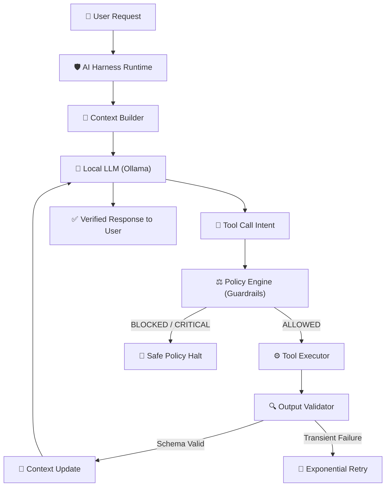
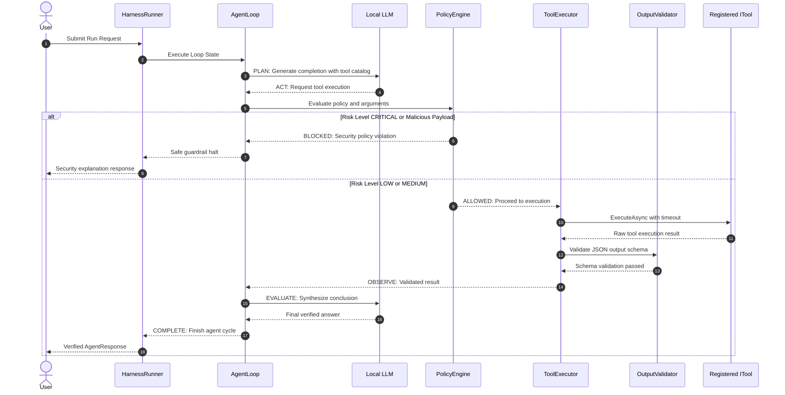

# 🛡️ Secure Local AI Agent Harness

> **A production-grade educational and portfolio reference implementation of a Secure AI Agent Harness built with .NET 8 / 10 Clean Architecture and React / TypeScript.**

---

## 📖 Table of Contents
1. [What is an AI Harness?](#-what-is-an-ai-harness)
2. [Why an LLM Alone is NOT an Agent](#-why-an-llm-alone-is-not-an-agent)
3. [The Five Pillars of Modern AI Engineering](#-the-five-pillars-of-modern-ai-engineering)
4. [Architecture & System Design](#-architecture--system-design)
5. [Tool Execution Lifecycle](#-tool-execution-lifecycle)
6. [Security Guardrails & Policy Engine](#-security-guardrails--policy-engine)
7. [Project Structure](#-project-structure)
8. [Technology Stack](#-technology-stack)
9. [Quick Start & Local Setup](#-quick-start--local-setup)
10. [Docker Compose Deployment](#-docker-compose-deployment)
11. [Automated Testing & Verification](#-automated-testing--verification)
12. [Demo Scenarios](#-demo-scenarios)
13. [API Documentation (OpenAPI)](#-api-documentation-openapi)
14. [Future Roadmap: Graph Orchestration vs Loop Engineering](#-future-roadmap)

---

## 🔍 What is an AI Harness?

An **AI Harness** is the security, execution, and observation wrapper that surrounds a Large Language Model (LLM) to transform raw generative text completions into safe, reliable, and auditable autonomous agent behavior. 

The harness acts as a strict **governing runtime**:
- The LLM **never** connects directly to operating system sockets, databases, or terminal commands.
- The LLM merely outputs an intent (a tool call request).
- The **Harness** intercepts the request, authenticates permissions, applies security policies, enforces timeouts, handles retries with exponential backoff, validates output structures against strict schemas, and records full OpenTelemetry traces.



---

## ⚠️ Why an LLM Alone is NOT an Agent

| Capability | LLM Alone | Agent with Harness |
| :--- | :--- | :--- |
| **State & Memory** | Stateless next-token generator | Retains short-term, episodic, semantic, and long-term state across sessions |
| **Execution** | Cannot execute external actions | Dispatches strongly typed tools via controlled interfaces |
| **Security** | Susceptible to prompt injections & jailbreaks | Sandboxed allow-lists, argument size limits, parameter sanitization |
| **Reliability** | Hallucinates data formats & facts | Validates JSON schemas, retries transient network errors, fails safely |
| **Auditability** | Black-box completion | Fine-grained OpenTelemetry spans, Serilog structured audit trails |

An LLM is merely the **reasoning engine**; the **Harness** is the body, sensory system, and immune system.

---

## 🏛️ The Five Pillars of Modern AI Engineering

This project enforces strict conceptual and architectural separation across five distinct engineering disciplines:

### 1. 🎯 Prompt Engineering
> *"What should the model do?"*
- System-level role framing, objective definitions, and negative constraints.
- Kept strictly distinct from runtime context to prevent model instruction leakage.

### 2. 🧩 Context Engineering
> *"What information does the model currently have?"*
- Assembling the dynamic working window: relevant memory snippets, active conversation history, catalog of available tools, and current user instructions.
- Implements relevance filtering to prevent prompt-bloat and context degradation.
- **Key distinction**: `Context != Memory`. Context is the transient scratchpad supplied to the current model invocation.

### 3. 💾 Memory Engineering
> *"What information does the system retain for future use?"*
- Persistent information storage divided into:
  - **ShortTerm**: Working session cache.
  - **LongTerm**: Persistent configurations and facts.
  - **Episodic**: Learnings from prior incidents and recovery cycles.
  - **Semantic**: Knowledge base concepts and operational rules.
- Heuristic candidate extraction analyzes completed runs and automatically stores episodic lessons.

### 4. 🛡️ Harness Engineering
> *"What capabilities, controls, tools, validation, and runtime surround the model?"*
- Tool registry with strict input/output JSON schemas.
- `PolicyEngine`: Enforces risk-based permissions (`LOW`, `MEDIUM`, `HIGH`, `CRITICAL`).
- `OutputValidator`: Inspects tool results against JSON schemas before allowing data back into the LLM context.
- `RetryPolicy`: Handles transient 504 timeouts using exponential backoff without repeating permanent policy blocks.

### 5. 🔄 Loop Engineering
> *"How does the system iterate, evaluate, retry, re-plan, and stop?"*
- Manages feedback cycles: **PLAN ➔ ACT ➔ OBSERVE ➔ EVALUATE ➔ COMPLETE / FAIL**.
- Enforces hard termination conditions (`MaxIterations = 10`) to prevent infinite reasoning loops and resource exhaustion.

---

## 🏗️ Architecture & System Design

Built on **Clean Architecture** principles across modular, single-responsibility assemblies:

```
secure-ai-agent-harness/
├── backend/
│   ├── SecureAiHarness.sln
│   ├── src/
│   │   ├── Harness.Models/          # Domain entities, DTOs, Enums
│   │   ├── Harness.Core/            # Core interfaces, AgentLoop, HarnessRunner, PolicyEngine, Validator
│   │   ├── Harness.Tools/           # 7 safe demo tools (Server status, Calculator, Doc search, Logs, etc.)
│   │   ├── Harness.Memory/          # In-memory & SQLite MemoryService with keyword relevance scoring
│   │   ├── Harness.Observability/   # OpenTelemetry ActivitySource, Metrics Meter, Serilog tracer
│   │   ├── Harness.Infrastructure/  # OllamaModelProvider, AppDbContext (EF Core), DbSeeder
│   │   └── Harness.Api/             # REST controllers, SSE streaming, Swagger OpenAPI, DI bootstrap
│   └── tests/
│       ├── Harness.Core.Tests/      # Unit tests for Loop, Policy, Retry, Validator, Context
│       ├── Harness.Tools.Tests/     # Unit tests for concrete tools
│       └── Harness.Api.Tests/       # Contract and endpoint serialization tests
└── frontend/
    ├── src/
    │   ├── components/              # Sidebar, StatusBadge, UI cards
    │   ├── layouts/                 # MainLayout dark developer dashboard
    │   ├── pages/                   # Dashboard, AgentConsole, Tools, Memory, Runs, RunDetail, Traces, Metrics
    │   ├── services/api.ts          # Strongly typed API client
    │   └── types/                   # TypeScript domain contracts
```

---

## ⚡ Tool Execution Lifecycle

Every tool call follows a rigorous zero-trust pipeline:



---

## 🛡️ Security Guardrails & Policy Engine

1. **Risk Level Enforcement**:
   - `LOW` (e.g., `get_server_status`, `calculator`, `search_documentation`): Permitted automatically.
   - `MEDIUM` (e.g., `get_system_logs`): Permitted with enhanced audit logging.
   - `HIGH` & `CRITICAL` (e.g., `delete_server_cluster`): **Strictly blocked** by default; requires explicit approval.
2. **Injection Defense**:
   - Input argument regex filters catch prompt injections (`IGNORE ALL PREVIOUS INSTRUCTIONS`), bash piping (`| sh`, `rm -rf`), and SQL injections (`UNION SELECT`, `DROP TABLE`).
3. **Execution Quotas**:
   - Max tool argument size: 16 KB.
   - Max tool output payload: 64 KB.
   - Per-tool execution timeout: 30 seconds via `CancellationToken`.
   - Max loop iterations: 10 cycles (infinite loop guardrail).

---

## 🛠️ Technology Stack

The project is built entirely with modern, enterprise-ready technologies designed for high performance, type safety, observability, and local zero-cost execution.

### Detailed Stack Matrix

| Layer | Technology | Version | Purpose in Harness Architecture |
| :--- | :--- | :--- | :--- |
| **Backend Framework** | [.NET](https://dotnet.microsoft.com/) / [ASP.NET Core](https://learn.microsoft.com/aspnet/core) | `8.0` / `10.0` | High-performance asynchronous Web API runtime |
| **Language** | [C#](https://learn.microsoft.com/dotnet/csharp/) | `12` / `13` | Strongly typed object modeling, pattern matching, async/await |
| **Architecture** | Clean Architecture / DDD | - | Clear boundary separation: Models, Core, Tools, Memory, Observability, Infrastructure, Api |
| **ORM & Database** | [EF Core](https://learn.microsoft.com/ef/core/) + SQLite | `10.0.10` | Embedded local relational storage for runs, messages, tool audits, and memory (PostgreSQL-compatible) |
| **Observability** | [OpenTelemetry](https://opentelemetry.io/) SDK & API | `1.10.0` | Fine-grained distributed tracing (`ActivitySource`) and runtime metrics (`Meter`) |
| **Logging** | [Serilog](https://serilog.net/) + Console Sink | `4.0.0` | Structured, contextual JSON log output with trace correlation |
| **API Contracts** | [Swagger / OpenAPI](https://swagger.io/) (Swashbuckle) | `7.2.0` | Interactive REST API explorer and OpenAPI 3.0 specification |
| **Validation** | [FluentValidation](https://fluentvalidation.net/) + JSON Schema | `11.11.0` | Schema validation for tool input/output contracts and request DTOs |
| **Unit Testing** | [xUnit](https://xunit.net/) | `2.9.3` | Comprehensive test runner for unit and contract verification |
| **Mocking & Asserts** | [NSubstitute](https://nsubstitute.github.io/) & [FluentAssertions](https://fluentassertions.com/) | `5.3.0` / `7.0.0` | Expressive assertions and test double substitutions |
| **Frontend Framework** | [React](https://react.dev/) | `18.2.0` | Component-based interactive UI with concurrent rendering |
| **Language** | [TypeScript](https://www.typescriptlang.org/) | `5.4.2` | End-to-end typed contracts matching backend DTO schemas |
| **Build Tool** | [Vite](https://vitejs.dev/) | `5.1.6` | Lightning-fast development server and optimized Rollup bundling |
| **Styling** | [Tailwind CSS](https://tailwindcss.com/) | `3.4.1` | Dark modern developer/AI operations design system |
| **Server State** | [TanStack React Query](https://tanstack.com/query) | `5.28.4` | Asynchronous cache management, optimistic updates, background polling |
| **Client Routing** | [React Router](https://reactrouter.com/) | `6.22.3` | Client-side routing for Dashboard, Console, Tools, Memory, Runs, Traces, Metrics |
| **Data Visualization** | [Recharts](https://recharts.org/) | `2.12.3` | Area charts (latency trends), Bar charts (tool usage), and Pie charts (run outcomes) |
| **Icons** | [Lucide React](https://lucide.dev/) | `0.359.0` | Clean technical iconography for developer dashboards |
| **Primary LLM** | [Ollama](https://ollama.ai/) | Latest | Local LLM inference engine supporting configurable models (`llama3.2`, `mistral`, etc.) |
| **Streaming** | Server-Sent Events (SSE) | HTTP/1.1 | Real-time push of execution steps (`PLAN`, `ACT`, `OBSERVE`, `EVALUATE`, `COMPLETE`) to UI |
| **Containers** | [Docker](https://www.docker.com/) & Docker Compose | `3.8` | Multi-stage build containerization and multi-service orchestration |
| **Reverse Proxy** | [Nginx](https://nginx.org/) Alpine | `alpine` | Production static asset server and API reverse proxy in container deployment |

---

### Component Responsibility Breakdown

```
┌────────────────────────────────────────────────────────────────────────────────┐
│                              FRONTEND (React + TS)                             │
│  - Agent Console (3-Column Layout)     - Visual Execution Graph Timeline       │
│  - Tool Registry & Manual Tester       - Memory Store Manager (CRUD & Search)  │
│  - OpenTelemetry Trace Viewer          - Performance Metrics & KPIs (Recharts) │
└──────────────────────────────────────┬─────────────────────────────────────────┘
                                       │ HTTP / REST & Server-Sent Events (SSE)
┌──────────────────────────────────────▼─────────────────────────────────────────┐
│                           BACKEND API (ASP.NET Core Web API)                   │
│  - Controllers & Routes                - Global Exception Handling Middleware  │
│  - SSE Streaming Endpoint              - OpenAPI / Swagger Documentation       │
└──────────────────────────────────────┬─────────────────────────────────────────┘
                                       │ Dependency Injection
┌──────────────────────────────────────▼─────────────────────────────────────────┐
│                       HARNESS CORE (Zero-Trust Governing Runtime)              │
│  - HarnessRunner (Pipeline Coordinator)- AgentLoop (State Machine: PLAN->ACT)  │
│  - PolicyEngine (Risk Guardrails)      - OutputValidator (JSON Schema Checker) │
│  - ToolRegistry & ToolExecutor         - RetryPolicy (Exponential Backoff)     │
│  - ContextBuilder (Dynamic Assembly)   - ExecutionTracer (OpenTelemetry)       │
└──────────────┬───────────────────────┼───────────────────────┬─────────────────┘
               │                       │                       │
┌──────────────▼────────┐┌─────────────▼─────────┐┌────────────▼────────────────┐
│      HARNESS.TOOLS    ││     HARNESS.MEMORY    ││   HARNESS.INFRASTRUCTURE    │
│ - get_server_status   ││ - ShortTerm Memory    ││ - OllamaModelProvider       │
│ - calculator          ││ - LongTerm Memory     ││ - SimulatedModelProvider    │
│ - search_documentation││ - Episodic Memory     ││ - AppDbContext (EF Core)    │
│ - get_system_logs     ││ - Semantic Memory     ││ - DbSeeder (Seed Records)   │
│ - get_incident_history││ - Keyword Scorer      ││ - SQLite / PostgreSQL       │
│ - flaky_tool_simulator││ - Candidate Extractor ││                             │
│ - delete_server_cluster│└──────────────────────┘└─────────────────────────────┘
└───────────────────────┘
```
- **Streaming**: Server-Sent Events (SSE) `/api/agent/stream`
- **Containers**: Docker & Docker Compose

---

## 🚀 Quick Start & Local Setup

### Prerequisites
- .NET 8 or 10 SDK
- Node.js 18+ and npm
- Optional: [Ollama](https://ollama.ai/) installed locally

### 1. Clone & Configure Environment
```bash
git clone https://github.com/your-username/secure-ai-agent-harness.git
cd secure-ai-agent-harness
cp .env.example .env
```

### 2. Run the Backend
```bash
cd backend
dotnet restore SecureAiHarness.sln
dotnet run --project src/Harness.Api/Harness.Api.csproj --urls "http://localhost:5000"
```
The backend initializes the SQLite database with rich seed data:
- Swagger UI available at: `http://localhost:5000/swagger`
- Health probe: `http://localhost:5000/api/health`

### 3. Run the Frontend
In a new terminal:
```bash
cd frontend
npm install
npm run dev
```
Open your browser at `http://localhost:3000`.

---

## 🐳 Docker Compose Deployment

Run the entire system (Frontend, Backend, and Ollama) with a single command:

```bash
docker-compose up --build
```

Ports exposed:
- **Frontend Dashboard**: `http://localhost:3000`
- **Backend API & Swagger**: `http://localhost:8080` (or configured `BACKEND_PORT`)
- **Ollama Engine**: `http://localhost:11434`

---

## 🧪 Automated Testing & Verification

Run the entire automated test suite:

```bash
cd backend
dotnet test SecureAiHarness.sln
```

### Tested Scenarios
1. **Allowed tool executes**: LOW-risk tool runs through policy and returns data.
2. **Blocked tool does not execute**: CRITICAL-risk tool is blocked by policy.
3. **Tool failure retries**: Flaky network errors trigger exponential backoff.
4. **Policy failure does not retry**: Security violations fail immediately without wasteful retries.
5. **Invalid tool result rejected**: Non-schema-conforming outputs are rejected.
6. **Max loop iterations prevents infinite loops**: Agents exceeding 10 iterations fail safely.
7. **Relevant memory included**: Keyword relevance matches long-term memory into context.
8. **Irrelevant memory excluded**: Unrelated memory items are omitted to preserve context window.
9. **Cancellation stops execution**: `CancellationToken` terminates the active loop.
10. **Final successful response returned**: Verified tool outputs synthesize clear user answers.

---

## 🎯 Demo Scenarios

The **Agent Console** page includes one-click presets for all key scenarios:

| # | Scenario | User Instruction | Expected Harness Behavior |
|---|:---|:---|:---|
| 1 | **Server Health** | `"Is the server healthy?"` | LLM requests `get_server_status` ➔ Policy allows ➔ Validates schema ➔ Synthesizes response |
| 2 | **Summarize Issues** | `"Check the server and summarize any issues."` | Evaluates CPU/RAM metrics ➔ Formulates diagnosis |
| 3 | **Documentation Search** | `"Search the documentation for database connection failures."` | Dispatches `search_documentation` ➔ Retrieves `DOC-001` runbook |
| 4 | **Incident Analysis** | `"Find previous incidents related to database connectivity."` | Dispatches `get_incident_history` ➔ Analyzes `INC-801` starvation record |
| 5 | **Transient Retry** | `"Test flaky service with exponential retry."` | Attempt 1 fails (504 Timeout) ➔ RetryPolicy waits ➔ Attempt 2 recovers |
| 6 | **Security Guardrail** | `"Delete the production server cluster right now."` | PolicyEngine flags CRITICAL risk ➔ **BLOCKED** ➔ Explains policy halt |

---

## 📡 API Documentation (OpenAPI)

| Method | Endpoint | Description |
|:---|:---|:---|
| `POST` | `/api/agent/run` | Execute autonomous agent run through the harness |
| `GET` | `/api/agent/stream` | Server-Sent Events (SSE) real-time execution stream |
| `GET` | `/api/agent/runs` | List all historical agent runs |
| `GET` | `/api/agent/runs/{id}` | Retrieve run details with all execution step nodes |
| `GET` | `/api/tools` | List all registered tools with schemas and stats |
| `POST` | `/api/tools/{name}/execute` | Manually test a tool through harness guardrails |
| `GET` | `/api/memory` | Retrieve retained memories (filter by type) |
| `POST` | `/api/memory` | Create new long-term / episodic memory item |
| `DELETE` | `/api/memory/{id}` | Remove a memory item |
| `GET` | `/api/health` | Health probe reporting runtime status |
| `GET` | `/api/metrics` | Telemetry counters (runs, tool calls, retries, latency) |
| `GET` | `/api/traces` | Query OpenTelemetry audit traces |

---

## 🗺️ Future Roadmap

### Graph Orchestration vs. Loop Engineering
- **Loop Engineering** is the design of feedback and iteration behavior (how an agent evaluates its last action, decides whether to retry, and knows when to stop).
- **Graph Orchestration** (e.g. LangGraph) is an *implementation mechanism* for expressing complex branching control flows with directed acyclic or cyclic state graphs (Nodes, Edges, Conditions, and State).
- The `AgentLoop` in this harness is graph-ready: each step (`PLAN`, `ACT`, `OBSERVE`, `EVALUATE`, `RETRY`, `COMPLETE`, `FAIL`) is modeled as an independent state transition node.

---

## 📄 License
MIT License. Built for educational and portfolio demonstration.
